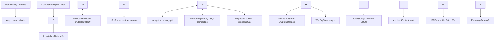

# Taller 4: Guía para cerrar la entrega

## Rúbrica y evidencias

|Criterio|Peso grupal|Evidencia necesaria|
|-|-:|-|
|Diseño|10 %|Material 3, identidad visual y diseño adaptable|
|Repositorio|10 %|Git público, tres ramas, contribuciones auténticas|
|Dos plataformas|25 %|Ejecutar Android y Web y capturar ambas|
|Persistencia SQLite o Firebase|25 %|SQLite nativo y sql.js, comprobar cierre/recarga|
|Pantallas y navegación|20 %|Siete pantallas, flujo compartido y créditos|

El informe debe incluir los puntos resaltados en verde del taller: reflexión comparativa, foto de arquitectura dibujada a mano y capturas de las dos plataformas. Las funciones extra pueden aportar hasta 0,3 puntos según el docente. La evaluación individual consta de dos preguntas de código o KMP.

## Diagrama para reproducir en papel



Copiar las cajas y flechas en una hoja y tomar una fotografía real. No entregar el gráfico digital en sustitución de la foto solicitada.

## Capturas reales

Tomar Inicio, Historial, Añadir, Metas, Perfil, Créditos y Transferir en Android y Web. El enunciado no fija una cantidad por plataforma, pero esta colección cubre toda la app. Añadir captura antes y después de reiniciar/recargar para la persistencia. En Android usar la cámara del emulador; en Web usar Win+Shift+S, procurando que se vea que se ejecuta en el navegador. No usar imágenes publicitarias como evidencia.

## Reflexión comparativa (guía, completar con experiencias reales)

* Android nativo: Kotlin/Jetpack Compose, SQLite y navegación específica de Android. Interfaz y lógica dependientes del ecosistema Android.
* iOS nativo: Swift/SwiftUI y SwiftData (versión final anterior), Xcode y herramientas de Apple. Reimplementación de modelos y UI para iOS.
* KMP: `commonMain` concentra reglas, SQL, interfaz, navegación y presentación. Las entradas y adaptadores de almacenamiento/HTTP permanecen específicos de cada target. Permite corregir la lógica en un único lugar y ejecutar ambos targets desde Windows. Contrapartida: configuración de Gradle, compatibilidad de dependencias y restricciones de almacenamiento y renderizado del navegador.
* Añadir observaciones propias tras ejecutar ambas plataformas: qué diferencias vieron en el diseño, en la primera compilación y en las pruebas.

## Funcionalidades adicionales propuestas para sustentar

Transferencias contables entre entornos con dos movimientos atómicos, CRUD de metas y abonos, tema oscuro persistente, búsqueda, filtro y consulta de tasa de cambio. No son transferencias bancarias ni notificaciones reales.

## Repositorio Git (no se ha modificado desde aquí)

Repositorio existente: https://github.com/Gcuellarf/MiPuenteFinanciero-KMP. Conservar Android y la carpeta `MiPuenteFinanciero\_iOS`; añadir `MiPuenteFinanciero\_KMP` como carpeta independiente y abrirla directamente desde Android Studio.

Desde una carpeta normal en Windows, clonar o actualizar el repositorio. Después de comprobar los dos targets:

```powershell
 git clone https://github.com/yulianaitaz/AplicacionesMoviles.git
 cd AplicacionesMoviles
 git switch main
 git pull --ff-only origin main
 git switch -c feature/kmp-ui-guillermo
```

Copiar la carpeta del ZIP dentro del repositorio (ajustar origen según ubicación). Comprobar que no tenga cachés ni `local.properties`:

```powershell
 git add MiPuenteFinanciero\_KMP
 git diff --cached --stat
 git commit -m "feat(kmp): add shared Android and Web finance project"
 git push -u origin feature/kmp-ui-guillermo
```

Crear Pull Request a main y revisar antes de integrar. No usar force push ni eliminar ramas si deben mostrar evidencia.

Propuesta de contribuciones después de integrar la base:

|Integrante|Rama|Trabajo auténtico|
|-|-|-|
|Guillermo Adolfo Cuéllar Fonseca|`feature/kmp-ui-guillermo`|Ejecutar ambos targets y revisar diseño adaptativo y navegación|
|José Luis Sánchez López|`feature/kmp-persistencia-jose`|Validar SQLite Android y Web, probar rollback y mejorar manejo de errores detectados|
|Yennifer Yuliana Uni Itaz|`feature/kmp-viewmodel-red-yennifer`|Validar ViewModel, consulta de red, estados y pruebas|

Cada integrante debe clonar/actualizar main, crear su rama, realizar cambios reales, revisar y publicar commits propios y abrir su Pull Request. No generar commits vacíos ni atribuir contribuciones ficticias. Antes de entregar, completar el informe con el enlace final, foto y capturas.

